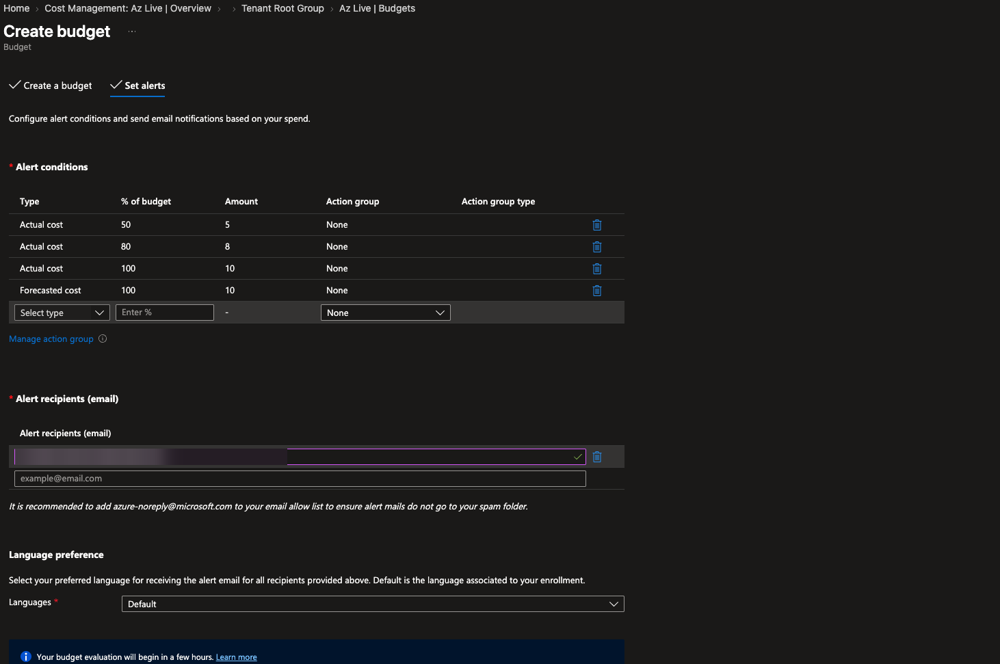
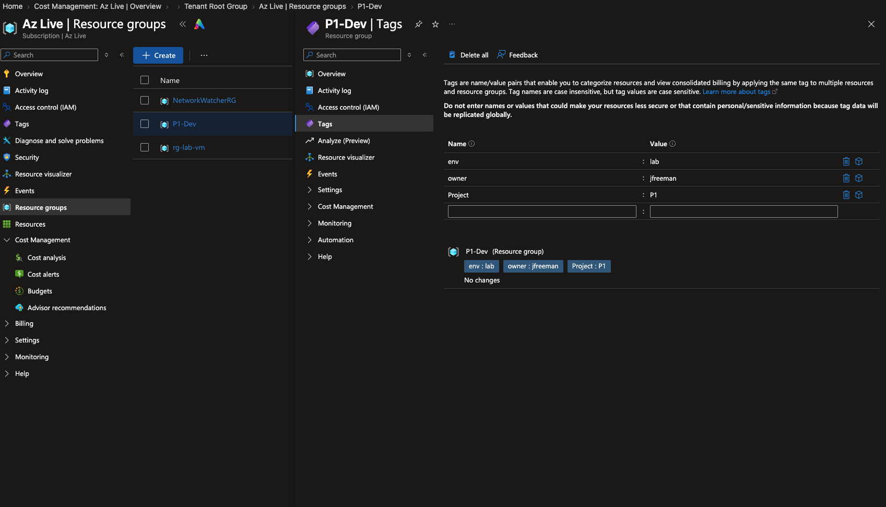
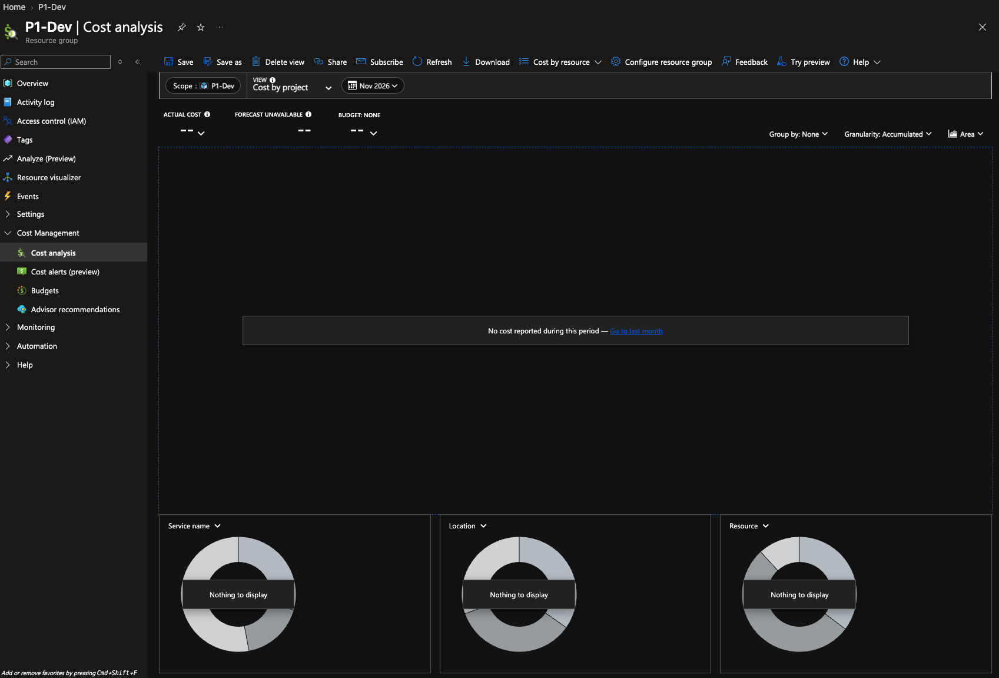
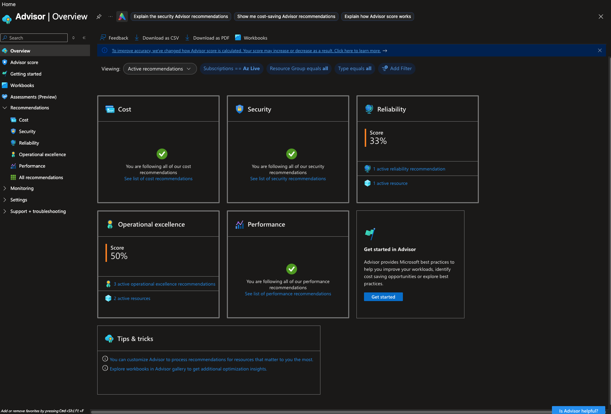

# 01: Lab Foundation and Cost Guardrails

> Before building anything in Azure, put security, spending alerts and a naming and tagging system in place so nothing gets out of control later.

## Scenario
A small team is starting to use Azure and has no guardrails. Nobody gets warned when spending climbs, resources have random names, and finance can't tell which project costs what. As the admin, I set up the foundation every later project builds on: MFA on the account, a monthly budget with early-warning alerts, a naming and tagging standard, and a cost report that breaks spending down by project.

## Architecture

```
Tenant Root Group (management group)
└── Subscription: Az Live
    ├── Budget: $10/month (alerts at 50%, 80%, 100% actual + 100% forecasted)
    └── Resource group: P1-Dev (tags: env=lab, owner=jfreeman, Project=P1)
        └── Saved Cost analysis view: "Cost by project"
```

| Resource | Name | Settings |
| --- | --- | --- |
| Budget | Monthly lab budget | $10/month, scope: subscription, email alerts |
| Resource group | `P1-Dev` | East US, 3 tags |
| Cost analysis view | Cost by project | Saved view at resource group scope |

## What I built
1. Turned on multi-factor authentication for the account that owns the subscription.
2. Created a **$10 monthly budget** at the subscription scope with four alerts:

   | Type | % of budget | Fires at |
   | --- | --- | --- |
   | Actual | 50% | $5 |
   | Actual | 80% | $8 |
   | Actual | 100% | $10 |
   | Forecasted | 100% | When Azure predicts the month will hit $10 |

3. Wrote a [naming and tagging standard](../docs/lab-standards.md) based on Microsoft's Cloud Adoption Framework.
4. Created a resource group with `env`, `owner` and `Project` tags.
5. Saved a **Cost by project** view in Cost analysis.
6. Reviewed Azure Advisor across its five Well-Architected pillars.

## Proof it works

**Budget alerts at the subscription scope**


**Tagged resource group**


**Saved "Cost by project" view** (empty because the resource group has no paid resources yet)


**Azure Advisor overview**


## What I learned
- **Budgets alert, they don't stop spending.** A budget only sends emails. To act automatically, such as shutting down VMs, you attach an **action group** to the alert.
- **Actual vs. forecasted alerts.** Actual alerts fire after the money is spent. Forecasted alerts look at the spending pace and warn before you get there.
- **Settings flow down the hierarchy.** A budget on the subscription covers every resource group under it.
- **Tags don't inherit.** Resources inside a resource group don't get its tags automatically. Enforcing that takes Azure Policy (Project 04).
- **Tag names are case-insensitive, but values are case-sensitive.** `Project=P1` and `project=p1` show up as two different values in cost reports, so a standard only works if everyone types it the same way.
- **Resource groups can't be renamed.** You have to create a new one and move the resources, so it pays to get the name right the first time.
- **Advisor maps to the Well-Architected Framework.** Its five categories (Cost, Security, Reliability, Operational excellence, Performance) are the five WAF pillars.

## Cost
- Approximate cost: $0 (budgets, tags, resource groups, Cost analysis and Advisor are free)
- Cleanup: none needed. The budget stays in place to protect every later project.

## Skills
`Azure Cost Management` · `Budgets & alerts` · `Tagging & naming standards` · `Cloud Adoption Framework` · `Azure Advisor` · `Well-Architected Framework` · `MFA`
