# 02: Entra ID Users and Groups at Scale

> Onboard a 20-person company in minutes instead of hours, and make access follow each person's job automatically.

## Scenario
A growing company hands IT a spreadsheet of new hires across IT, Sales and HR. Creating accounts one at a time is slow and error-prone, and when people change jobs, nobody remembers to update their group memberships, so they keep access they no longer need. As the identity admin, I bulk-imported the users from a CSV, organized them into department security groups, built a dynamic group driven by HR data, invited an outside vendor as a guest, and confirmed every change in the audit logs and from the command line.

## Architecture

```
Tenant: Freeman Lab (freemanlab.onmicrosoft.com), Microsoft Entra ID P2
├── 20 users (bulk-created from CSV; IT x6, Sales x8, HR x6)
├── Security groups (assigned membership)
│   ├── SG-IT     (6)
│   ├── SG-Sales  (8)
│   └── SG-HR     (6)
├── Security group (dynamic membership)
│   └── SG-Dyn-Sales   rule: (user.department -eq "Sales")
└── Guest user: Guest Tester (Vendor), invited through B2B collaboration
```

| Resource | Name | Settings |
| --- | --- | --- |
| Tenant | Freeman Lab | Separate test tenant with an Entra ID P2 trial |
| Users | 20 fictional employees | Bulk create from CSV, with job title, department and usage location |
| Assigned groups | `SG-IT`, `SG-Sales`, `SG-HR` | Security, assigned membership, not role-assignable |
| Dynamic group | `SG-Dyn-Sales` | Security, Dynamic User, `(user.department -eq "Sales")` |
| Guest | Guest Tester (Vendor) | External user, invitation accepted |

## What I built
1. Set up a **separate test tenant** with an **Entra ID P2** trial, so P1/P2 features could be tested without touching the tenant that holds my Azure subscription.
2. **Bulk-created 20 users** from a CSV with department and job title filled in. The first upload failed because the CSV still used a domain from another tenant. I corrected the domain and the second run succeeded for all 20.
3. Created three **assigned security groups**, one per department, and left "Microsoft Entra roles can be assigned" off, since these groups grant app and data access, not admin rights.
4. Built a **dynamic group** with the rule `(user.department -eq "Sales")` and tested it with **Validate Rules** before saving: a Sales user matched, an HR user didn't.
5. **Moved an employee** (Isaac Morgan) from HR to Sales by changing one field. The dynamic group added him automatically; the assigned HR group kept him, showing how privilege creep happens.
6. **Invited an external guest** through B2B collaboration and accepted the invitation from the guest's own account.
7. Traced the department change in the **audit logs**, including the old and new values.
8. Confirmed the results from **Cloud Shell** with Azure CLI, signing in to the lab tenant from a shell in a different tenant.

## Proof it works

**Entra ID P2 license active in the lab tenant**
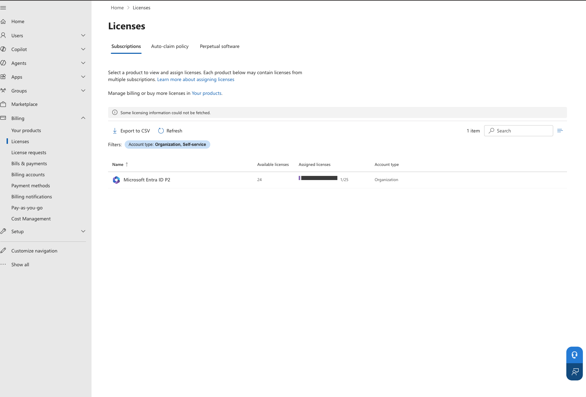

**Bulk create: all 20 users succeeded**
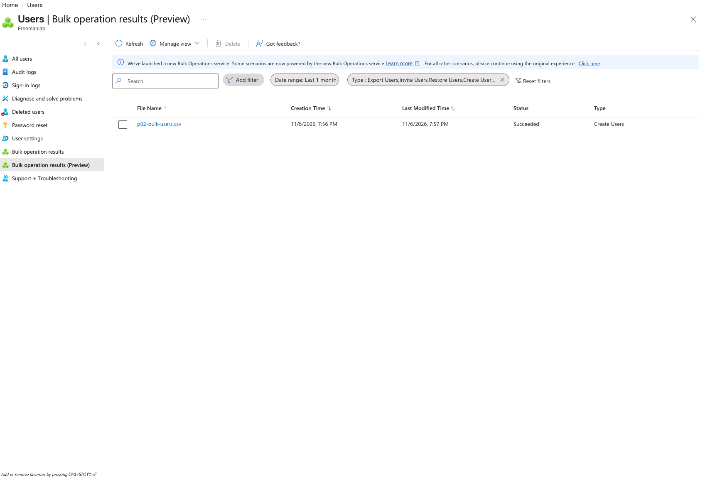

**Imported user with job title and department**
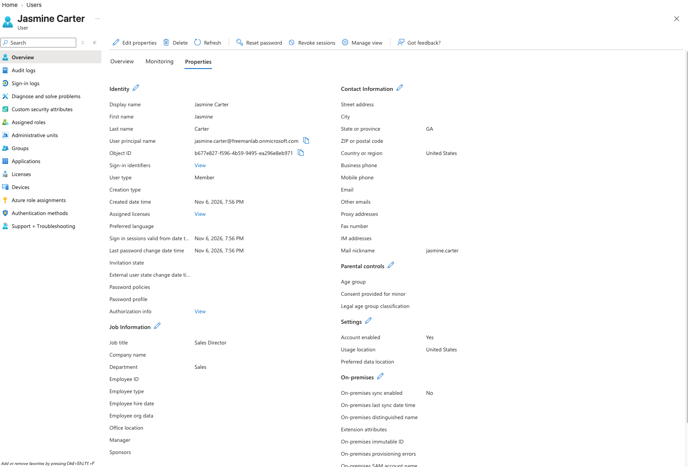

**Three assigned security groups**
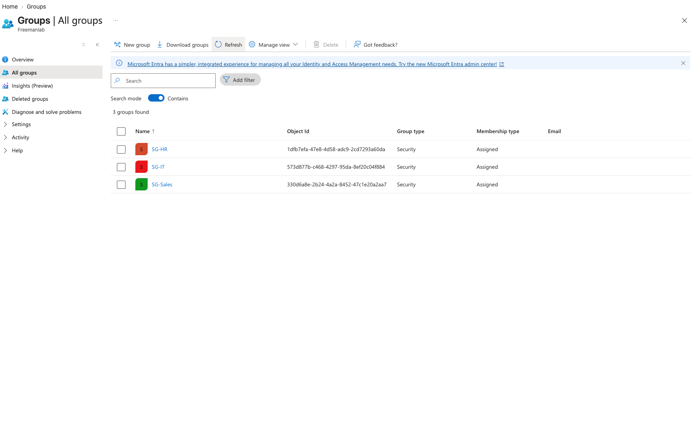

**Dynamic rule tested before going live** (Sales user ✅, HR user ❌)
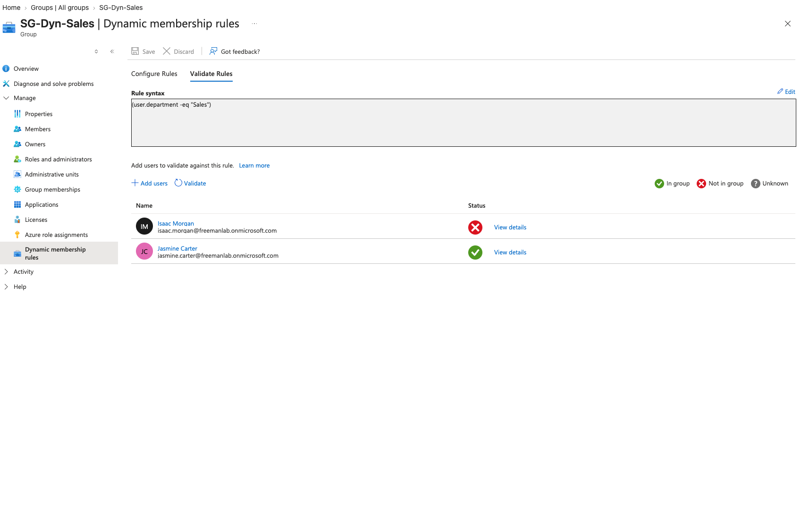

**Dynamic group before the change: 8 Sales users, none added by hand**
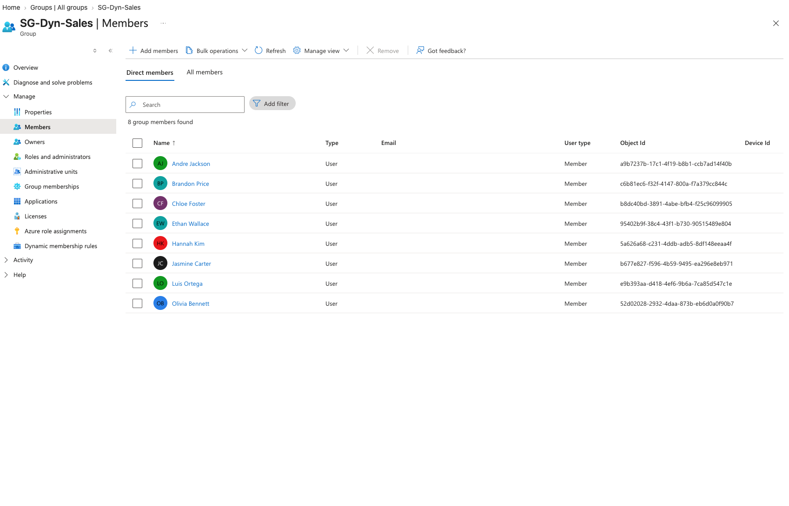

**Isaac's department changed from HR to Sales**
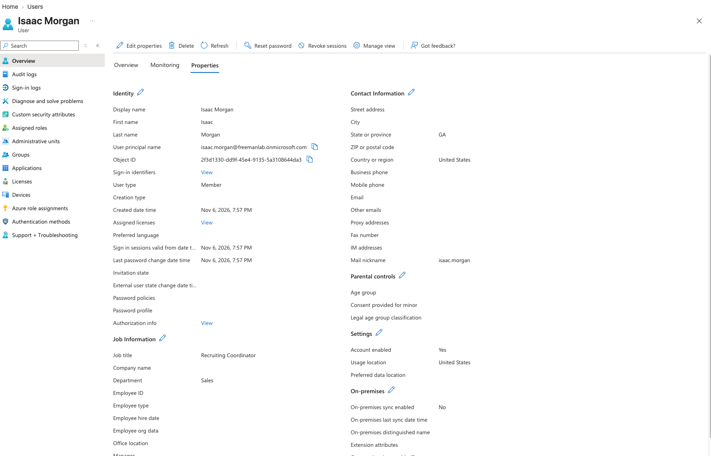

**Dynamic group after the change: Isaac added automatically (9 members)**
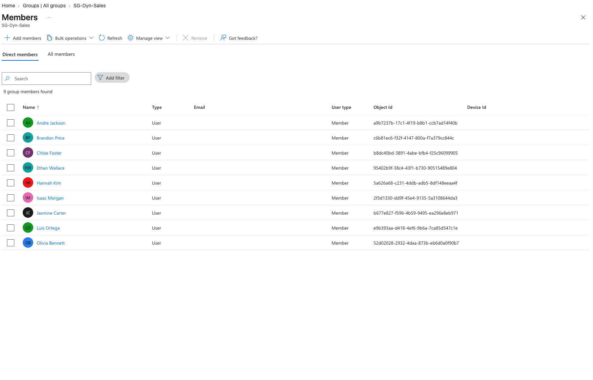

**Assigned HR group after the change: Isaac is still there (privilege creep)**
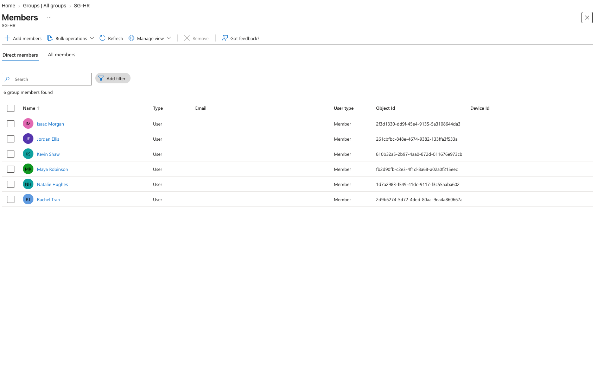

**Guest user with User type: Guest and invitation accepted** (personal email blurred)
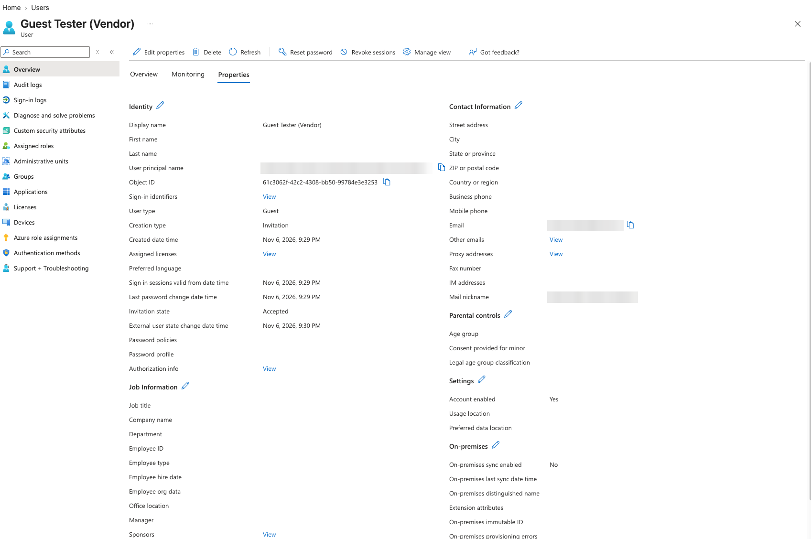

**Audit log showing the exact change: Department changed from "HR" to "Sales"**
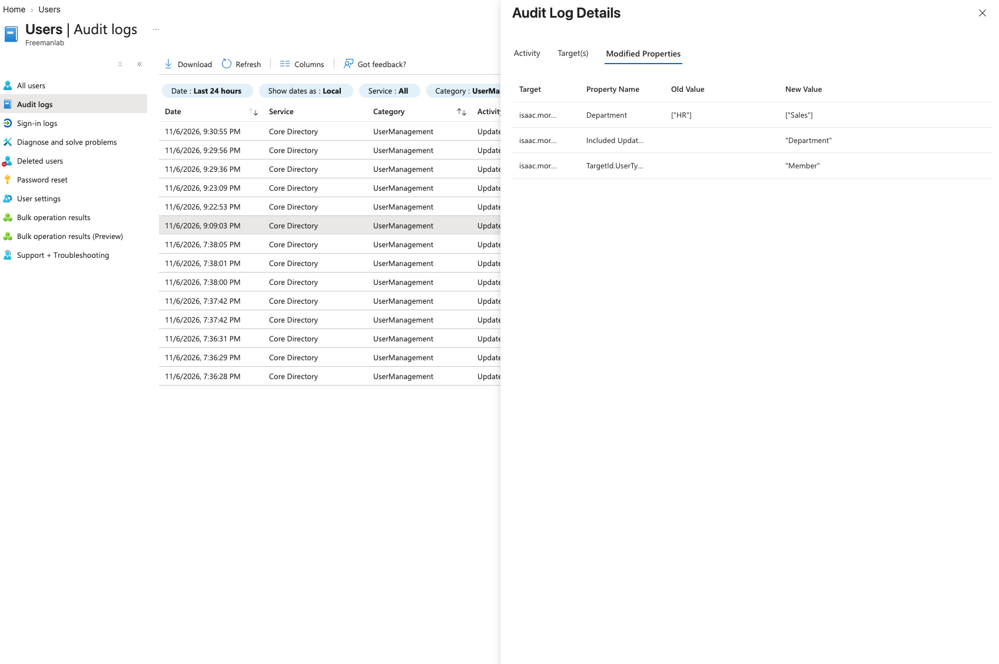

**Azure CLI confirmation: 22 accounts, 4 groups, the guest, and 9 dynamic members including Isaac**
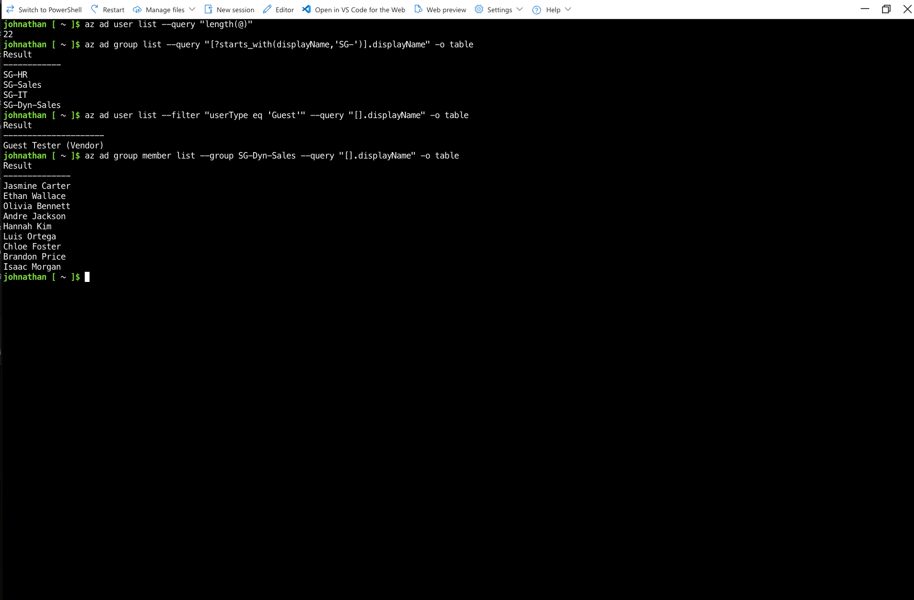

**Screen recordings**
- [Changing the department](videos/change-department.mp4)
- [The dynamic group updating on its own](videos/dynamic-group-updates.mp4)

## What I learned
- **Dynamic groups turn HR data into access.** When a department changes, group membership follows, so there are no tickets, forgotten removals or day-one access gaps.
- **Assigned groups cause privilege creep.** Isaac kept HR access after moving to Sales because nothing told the assigned group that his job changed. The fixes are dynamic groups where HR data is reliable, and access reviews for everything else.
- **Test rules before they go live.** A typo like `"sales"` or a trailing space could silently remove a whole department's access. Validate Rules catches that with known users first.
- **A username must use a domain the tenant owns.** The first bulk upload failed because the CSV was copied from another tenant. This is one of the most common real-world import failures.
- **Role-assignable groups are a one-way choice.** That setting can only be chosen at creation, locks down who can manage the group, and can't be combined with dynamic membership, so admin groups stay small and tightly controlled.
- **Guests keep their own identity.** The vendor signs in with their own account, so I never manage their password, and removing the guest cuts off access cleanly. The `#EXT#` in the username marks the account as external in logs.
- **Audit logs keep the before and after values.** That's what makes it possible to investigate a change or confidently reverse one.
- **Personal Microsoft accounts can't buy business licenses.** Starting the P2 trial required a work account, so I set up a separate test tenant, which is also how many companies keep experiments away from production.
- **The new bulk-operations service skips some optional columns.** City and Office didn't import, while every required field and Department did. Always spot-check a few imported records.

## Cost
- Approximate cost: $0. Users, groups and guests are free; dynamic groups ran on a one-month Entra ID P2 free trial.
- Cleanup: users and groups stay for later identity projects. The P2 trial gets cancelled before it converts to a paid subscription.

## Skills
`Microsoft Entra ID` · `Bulk user provisioning` · `Security groups` · `Dynamic membership rules` · `B2B guest access` · `Audit logs` · `Azure CLI` · `Identity lifecycle (joiner-mover-leaver)` · `Least privilege`
