# 03: Least Privilege with Custom RBAC Roles

> Give the help desk exactly what they need to restart servers, and nothing that lets them delete or create one.

## Scenario
The help desk gets tickets like "the app server is frozen, can you reboot it?" They need to start, stop and restart virtual machines. The usual shortcut is to give them Contributor or Virtual Machine Contributor, but both roles also allow deleting production servers and creating new ones that cost money. As the cloud admin, I built a custom Azure RBAC role with only the actions the help desk actually needs, assigned it to a group at resource group scope, and proved from the help desk user's own login that restart works while delete and create are blocked.

## Architecture

```
Subscription
├── Custom role: VM Operator (Help Desk)   assignable at subscription scope
└── Resource group: rg-az104-p03-dev       tags: project=p03, env=lab, owner
    ├── vm-p03-test   Ubuntu 22.04, Standard_B1s, no public IP, no open ports
    └── Role assignment: sg-helpdesk -> VM Operator (Help Desk)

Microsoft Entra ID
└── sg-helpdesk (security group, assigned)
    └── Help Desk Tech (test user)
```

| Resource | Name | Settings |
| --- | --- | --- |
| Resource group | `rg-az104-p03-dev` | East US, tagged for cost tracking |
| Test VM | `vm-p03-test` | Standard_B1s, no public IP, no inbound rules |
| Custom role | `VM Operator (Help Desk)` | 7 actions: read, instance view, start, restart, deallocate, power off, read resource groups |
| Group | `sg-helpdesk` | Security group, assigned membership |
| Role assignment | `sg-helpdesk` → `VM Operator (Help Desk)` | Scope: `rg-az104-p03-dev` only |

**Role actions**
```json
"actions": [
  "Microsoft.Compute/virtualMachines/read",
  "Microsoft.Compute/virtualMachines/instanceView/read",
  "Microsoft.Compute/virtualMachines/start/action",
  "Microsoft.Compute/virtualMachines/restart/action",
  "Microsoft.Compute/virtualMachines/deallocate/action",
  "Microsoft.Compute/virtualMachines/powerOff/action",
  "Microsoft.Resources/subscriptions/resourceGroups/read"
]
```

## What I built
1. Created a **tagged resource group** and a small **test VM with no public IP and no open ports** from Cloud Shell, so the test server was never reachable from the internet.
2. Reviewed the built-in **Virtual Machine Contributor** role and confirmed it grants `Microsoft.Compute/virtualMachines/*`, which includes **Delete Virtual Machine**. That's why it didn't fit.
3. Built the **custom role** from scratch in the portal's JSON editor with only seven actions, and made it assignable across the subscription so it can be reused.
4. Created a **help desk test user** and the **`sg-helpdesk`** security group.
5. **Assigned the role to the group**, not the user, at **resource group scope** only.
6. Verified effective permissions with **Check access**.
7. **Signed in as the help desk user** in a private window and tested both directions: restart succeeded, delete and create failed with authorization errors.
8. Exported the role definition and the assignment from **Azure CLI**.

## Proof it works

**Test VM created with no public IP and no open ports**
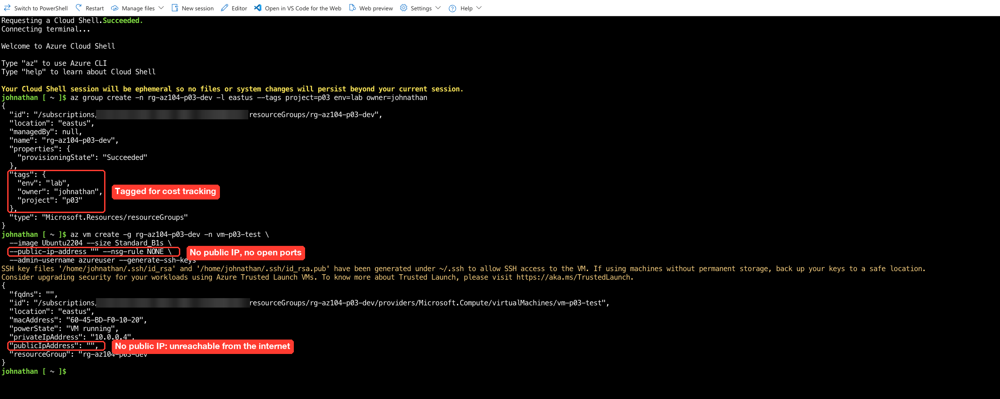

**Why not the built-in role: Virtual Machine Contributor can delete VMs**
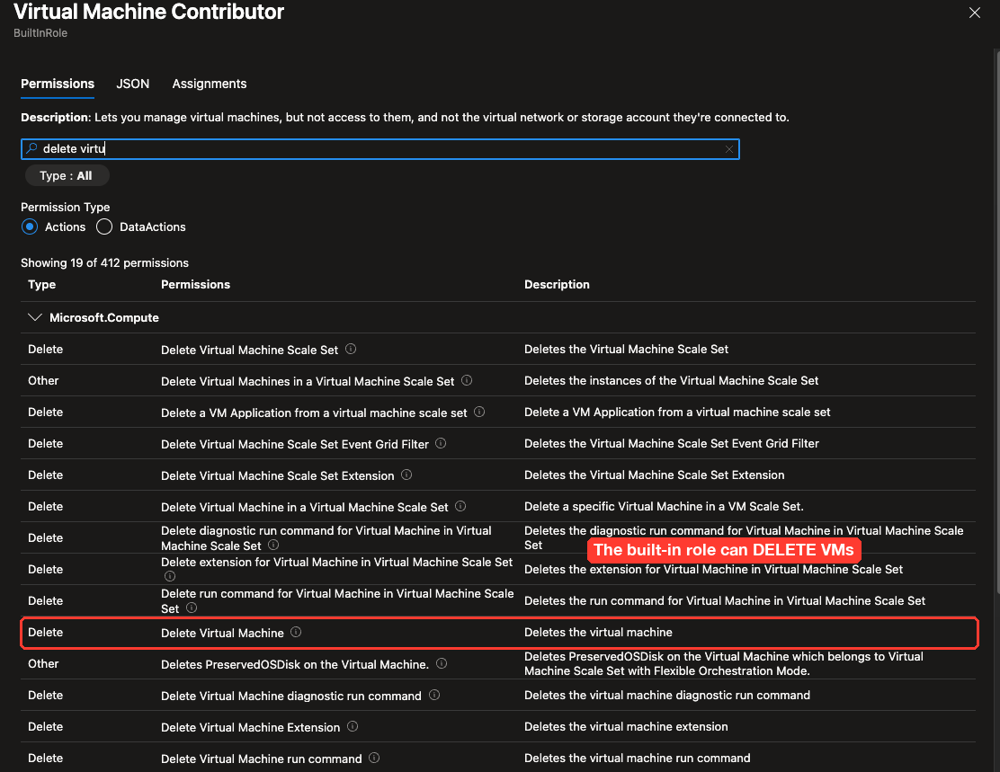

**The custom role in JSON: only 7 actions**
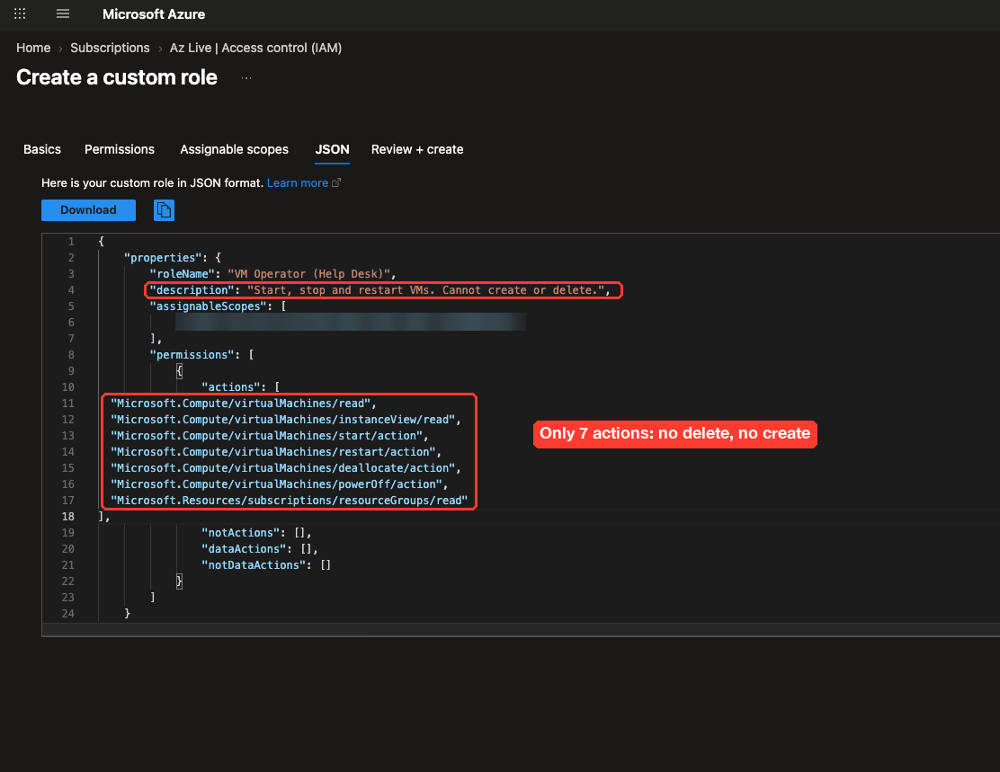

**Custom role created**
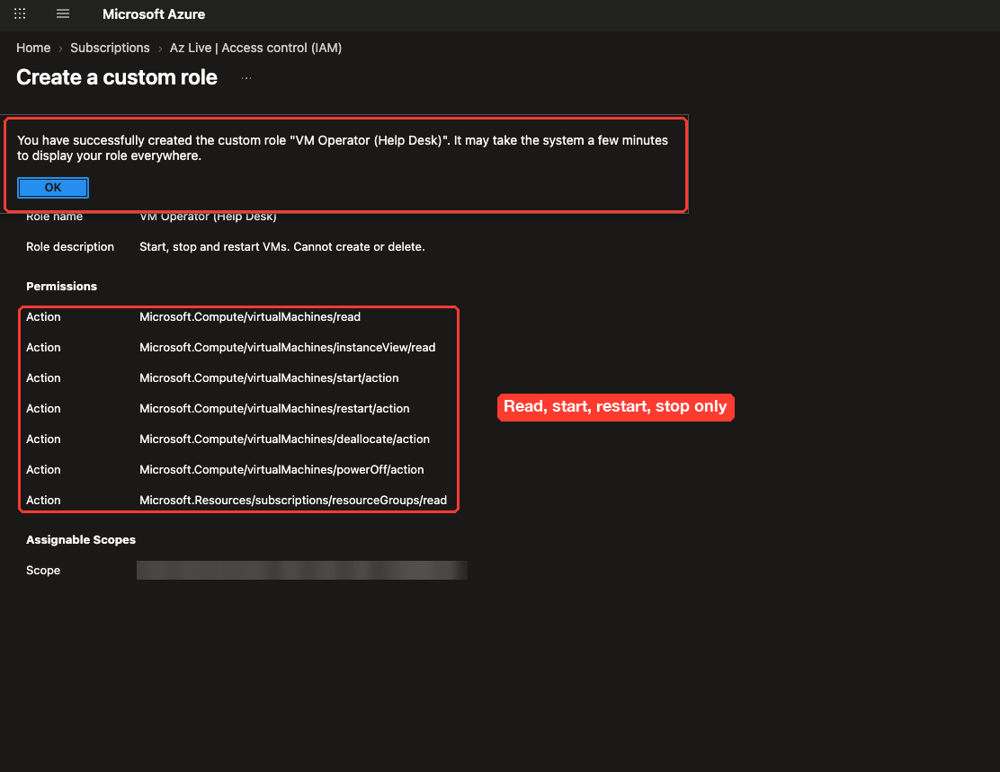

**Access goes to a group, not a person**
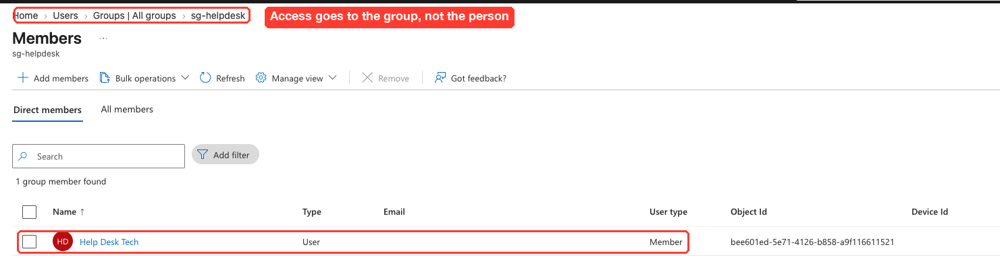

**Role assigned to the group, scoped to this resource group only**
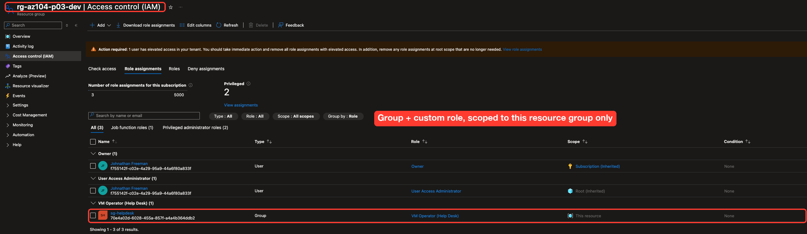

**Check access: the group's effective role**
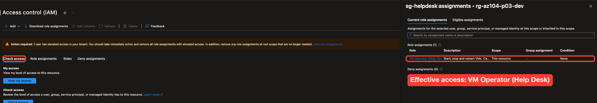

**Signed in as the help desk user: restart allowed ✅**
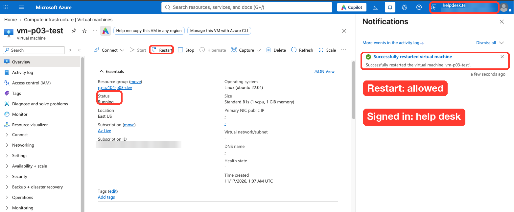

**Delete denied ❌** (`does not have authorization to perform action 'Microsoft.Compute/virtualMachines/delete'`)
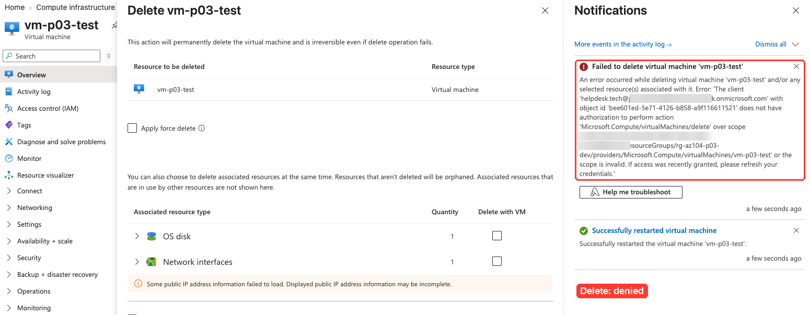

**Create denied ❌** (`AuthorizationFailed` on deployment validation)
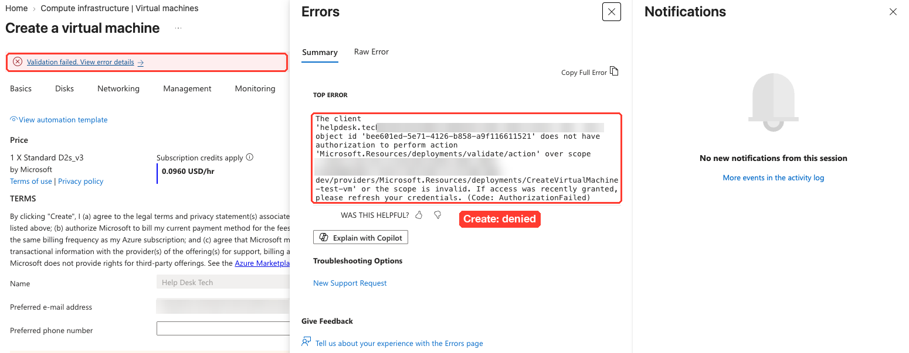

**Azure CLI: the role definition and the assignment**
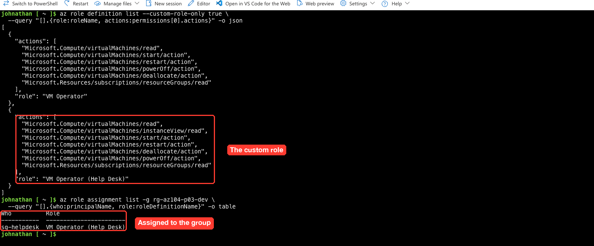

**Cleanup: test VM deleted, nothing left running**
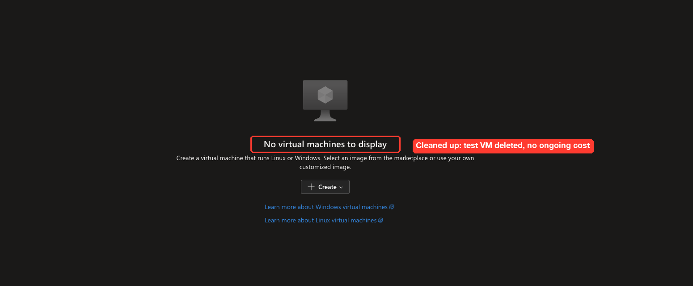

## What I learned
- **Role names don't tell you what a role allows.** "Virtual Machine Contributor" sounds right for the help desk, but the `*` wildcard includes delete. Always read the actions list before assigning.
- **Access = who + what + where.** The group is who, the custom role is what, and the resource group is where. Keeping the scope small limits the damage if an account is ever compromised.
- **Assign roles to groups, not people.** New techs get the right access by joining the group, and leavers lose it by being removed from it.
- **Test both directions.** Proving that restart works matters as much as proving delete fails; a role that blocks too much just creates more tickets.
- **Creating a VM needs more than VM permissions.** The create attempt failed on `Microsoft.Resources/deployments/validate/action`, because the portal deploys a template first. Reading the denied action in the error message tells you exactly what's missing.
- **Azure RBAC and Entra ID roles are separate systems.** This role controls Azure resources; it gives no rights in Entra ID, and an Entra admin role gives no rights to Azure resources by default.
- **Check access is the first stop for access tickets.** It shows a user's effective role and where it comes from, instead of guessing.

## Cost
- Approximate cost: a few cents. The Standard_B1s VM ran only for the length of the lab; custom roles, groups and role assignments are free.
- Cleanup: deleted the test VM the same day, so nothing is left running. The custom role and `sg-helpdesk` stay for later projects.

## Skills
`Azure RBAC` · `Custom roles` · `Least privilege` · `Role assignment scope` · `Microsoft Entra ID groups` · `Check access` · `Azure CLI` · `Azure Virtual Machines`
